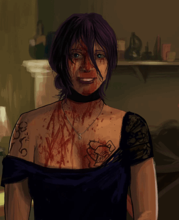

  

 

 

### &nbsp;&nbsp; 🕹️ PLAYER_PROFILE.EXE

<ul>
  <li><b>CLASS:</b> Software Dev & Comic Scriptwriter</li>
  <li>Tatsuki Fujimoto & Junji Ito Disciple</li>
  <li>Comic, Literature & Cinema</li>
</ul>

  &nbsp;&nbsp;&nbsp;
  
  
  
  

 

---

  

 

  

