  

 

 

### &nbsp;&nbsp; 😺 IBRUH.EXE

<ul>
  <li> &nbsp;&nbsp;  <b>CLASS:</b> Software Dev & Comic Scriptwriter</li>
  <li> &nbsp;&nbsp;  Tatsuki Fujimoto & Junji Ito Disciple</li>
  <li> &nbsp;&nbsp;  Comic, Literature & Cinema</li>
  <li></li>
</ul>

  &nbsp;&nbsp;&nbsp;
  
  
  
  

 

---

  
  

---

 

  

