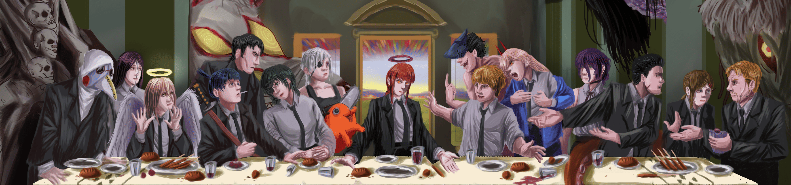

  

 

 

&nbsp;&nbsp;&nbsp;

<ul>
  <li><b>𝙲𝙻𝙰𝚂𝚂 :</b> 𝚂𝚘𝚏𝚝𝚠𝚊𝚛𝚎 𝙳𝚎𝚟 & 𝙲𝚘𝚖𝚒𝚌 𝚂𝚌𝚛𝚒𝚙𝚝𝚠𝚛𝚒𝚝𝚎𝚛</li>
  <li>𝚃𝚊𝚝𝚜𝚞𝚔𝚒 𝙵𝚞𝚓𝚒𝚖𝚘𝚝𝚘 & 𝙹𝚞𝚗𝚓𝚒 𝙸𝚝𝚘 𝙳𝚒𝚜𝚌𝚒𝚙𝚕𝚎</li>
  <li>𝙲𝚘𝚖𝚒𝚌, 𝙻𝚒𝚝𝚎𝚛𝚊𝚝𝚞𝚛𝚎 & 𝙲𝚒𝚗𝚎𝚖𝚊</li>
</ul>

&nbsp;&nbsp;&nbsp;

  &nbsp;&nbsp;&nbsp;
  
  
  
  

 

---

  
  

---

 

  

